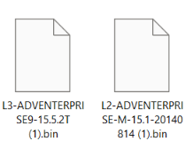
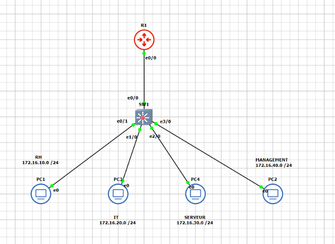
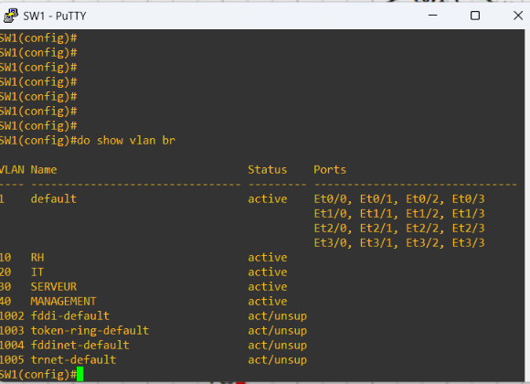
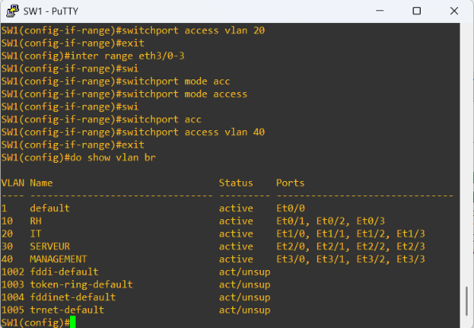
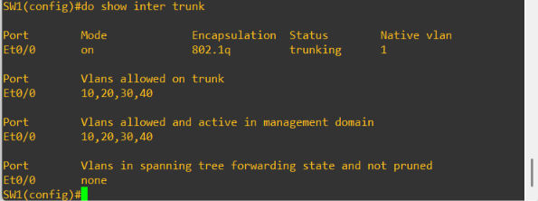
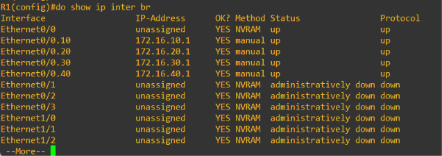
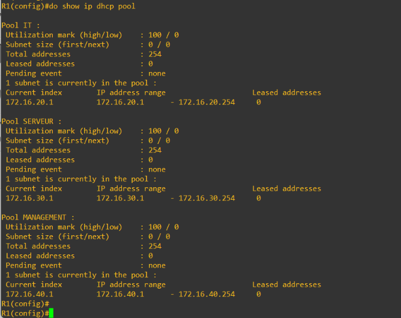
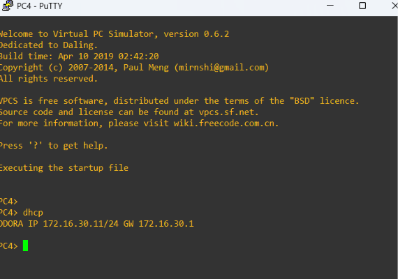
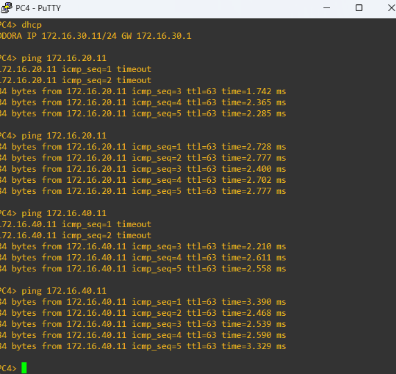

# SecurLab Pro : Partie 1, configuration de base

Premier volet du projet **SecurLab Pro** : une infrastructure de cybersécurité montée sous **GNS3** pour apprendre en construisant.

Cette partie couvre la configuration de base du réseau : **VLAN, allocation des ports, trunk, sous-interfaces et DHCP**.

---

## Contexte et matériel

| Rôle | Équipement | Image IOS |
|---|---|---|
| Routeur L3 | `R1` | `L3-ADVENTERPRISE9-15.5.2T` |
| Switch L2 | `SW1` | `L2-ADVENTERPRISE-M-15.1-20140814` |
| Postes | `PC1` à `PC4` | VPCS |

Les images IOS utilisées (fichiers `.bin` importés dans GNS3) :



**Source des images :** <https://github.com/hegdepavankumar/Cisco-Images-for-GNS3-and-EVE-NG/blob/main/README.md>

> ⚠️ Les images IOS Cisco sont soumises à licence. Elles ne sont **pas** incluses dans ce dépôt (le `.gitignore` bloque les `.bin`). Le lien ci-dessus est donné uniquement comme référence de l'origine des fichiers utilisés dans le lab.

## Topologie



## Plan d'adressage

| VLAN | Nom | Réseau | Passerelle (R1) | Ports du switch | DHCP assuré par |
|---|---|---|---|---|---|
| 10 | RH | 172.16.10.0/24 | 172.16.10.1 | Et0/1 à Et0/3 | **Serveur AD (partie suivante)** |
| 20 | IT | 172.16.20.0/24 | 172.16.20.1 | Et1/0 à Et1/3 | Routeur R1 |
| 30 | SERVEUR | 172.16.30.0/24 | 172.16.30.1 | Et2/0 à Et2/3 | Routeur R1 |
| 40 | MANAGEMENT | 172.16.40.0/24 | 172.16.40.1 | Et3/0 à Et3/3 | Routeur R1 |

Lien trunk : `SW1 Et0/0` ↔ `R1 Et0/0`.

## Fichiers de configuration

| Fichier | Contenu |
|---|---|
| [`configs/partie-1/SW1-config.txt`](configs/partie-1/SW1-config.txt) | VLAN, ports access, trunk |
| [`configs/partie-1/R1-config.txt`](configs/partie-1/R1-config.txt) | Sous-interfaces et DHCP |

Pour appliquer une config : ouvrir la console de l'équipement dans GNS3, puis coller le contenu du fichier (les lignes qui commencent par `!` sont des commentaires).

---

## Étape 1 : Création des VLAN (SW1)

On crée les quatre VLAN et on leur donne un nom. À ce stade, tous les ports sont encore dans le VLAN 1 par défaut.

```
vlan 10
 name RH
vlan 20
 name IT
vlan 30
 name SERVEUR
vlan 40
 name MANAGEMENT
```

Vérification avec `show vlan brief` :



## Étape 2 : Allocation des ports par VLAN (SW1)

Chaque groupe de 4 ports est réservé à un VLAN (mode `access`). Un nouveau poste branché sur l'un de ces ports rejoint automatiquement le bon réseau, sans reconfiguration.

```
interface range Ethernet0/1 - 3
 switchport mode access
 switchport access vlan 10
```

(même principe pour Et1/0-3 → VLAN 20, Et2/0-3 → VLAN 30, Et3/0-3 → VLAN 40)

Vérification avec `show vlan brief` : les ports sont répartis par VLAN.



## Étape 3 : Trunk 802.1Q (SW1 vers R1)

Un seul câble transporte les quatre VLAN jusqu'au routeur grâce au trunk 802.1Q.

```
interface Ethernet0/0
 switchport trunk encapsulation dot1q
 switchport mode trunk
 switchport trunk allowed vlan 10,20,30,40
```

Vérification avec `show interfaces trunk` : encapsulation 802.1q, statut `trunking`, VLAN 10, 20, 30 et 40 autorisés.



## Étape 4 : Interfaces virtuelles sur le routeur (R1)

Le routeur crée une **sous-interface par VLAN** (technique « router-on-a-stick »). Chacune sert de passerelle à son réseau, y compris pour le VLAN 10.

```
interface Ethernet0/0.10
 encapsulation dot1Q 10
 ip address 172.16.10.1 255.255.255.0
```

(même principe pour .20, .30 et .40)

Vérification avec `show ip interface brief` : les sous-interfaces `Ethernet0/0.10` à `.40` sont `up/up` avec leurs adresses.



## Étape 5 : DHCP (R1)

Le routeur distribue les adresses des VLAN **20 (IT), 30 (SERVEUR) et 40 (MANAGEMENT)**, avec un pool par VLAN : chaque poste reçoit automatiquement son adresse et sa passerelle.

```
ip dhcp excluded-address 172.16.30.1 172.16.30.10
ip dhcp pool SERVEUR
 network 172.16.30.0 255.255.255.0
 default-router 172.16.30.1
```

Vérification avec `show ip dhcp pool` : trois pools (IT, SERVEUR, MANAGEMENT) et aucun pour le VLAN 10.



### Pourquoi pas de pool DHCP pour le VLAN 10 (RH) ?

C'est un choix volontaire : le VLAN 10 regroupe les **postes du domaine**, et son DHCP sera assuré par le **serveur Windows (Active Directory)** dans une prochaine partie, comme dans une vraie entreprise. Les raisons :

- **Les postes du domaine ont besoin de bonnes options DHCP.** Un serveur Windows donne aux clients l'adresse du DNS du domaine (le contrôleur de domaine) et le nom de domaine. Sans ça, un poste ne retrouve pas l'AD et ne peut pas rejoindre le domaine ni appliquer les GPO.
- **Intégration avec le DNS.** Le serveur DHCP Windows peut enregistrer automatiquement les postes dans le DNS du domaine.
- **Gestion centralisée.** Étendues, réservations d'adresses et journaux se gèrent depuis la console Windows, au même endroit que les utilisateurs et les machines.
- **Un seul serveur DHCP par réseau.** Avoir deux serveurs DHCP sur le même VLAN (le routeur et Windows) provoque des conflits, car le poste accepte l'offre du premier qui répond. On a donc laissé le routeur en dehors du VLAN 10.

Le routeur reste malgré tout la **passerelle** du VLAN 10 (`172.16.10.1`) : seule la distribution des adresses change de main.

**À prévoir pour la partie AD :** le DHCP fonctionne par diffusion (broadcast) et celle-ci ne traverse pas un routeur. Si le serveur Windows n'est pas dans le VLAN 10, il faudra ajouter un relais DHCP sur la sous-interface `Ethernet0/0.10` du routeur :

```
interface Ethernet0/0.10
 ip helper-address <IP du serveur Windows>
```

---

## Étape 6 : Tests

**1. Un poste du VLAN 30 obtient son IP en DHCP** (`PC4` reçoit `172.16.30.11/24`, passerelle `172.16.30.1`) :



**2. Communication inter-VLAN** : depuis `PC4` (VLAN 30), des pings vers un poste du VLAN 20 puis du VLAN 40 réussissent. Le `ttl=63` prouve que les paquets passent bien par le routeur. Les premiers paquets en timeout sont normaux (résolution ARP).



---

## Suite du projet

Voir l'[index du dépôt](README.md). Chaque partie a son propre fichier.

## Auteure

**Caroline**, étudiante en Réseaux et Sécurité.
